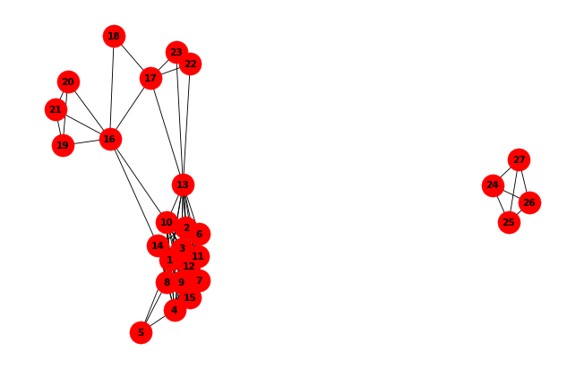
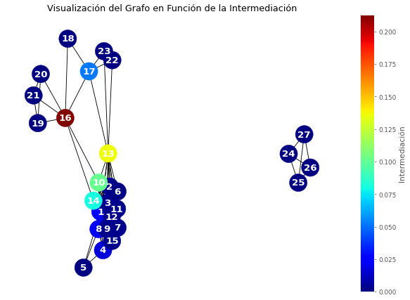
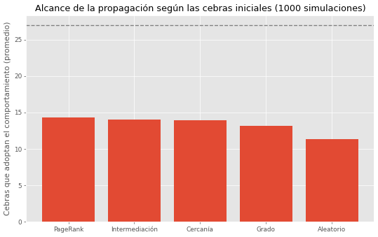
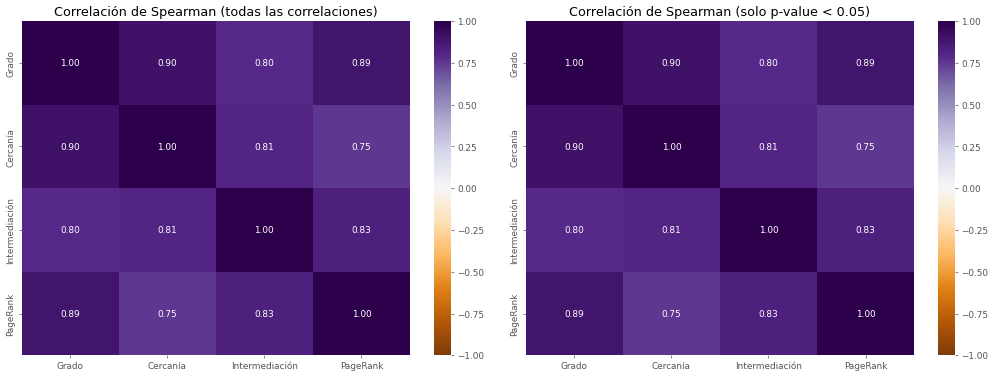

# Análisis de la red social de cebras de Grévy 🦓

Análisis de redes sobre las interacciones entre 27 cebras de Grévy en Kenia, usando Python y NetworkX. 
El proyecto combina medidas de centralidad, una simulación de propagación y un análisis de correlación para responder una pregunta central:

> **¿Qué medida de centralidad permite elegir mejor a las cebras que más propagan un comportamiento por la red?**

## Dataset

Red `moreno_zebra` de [KONECT](http://konect.cc/networks/moreno_zebra/): una red **no dirigida** con **27 nodos** (cebras) y **111 aristas** (interacciones entre dos cebras durante el estudio). Los datos provienen de Sundaresan et al. (2007).

## Estructura de la red

La red tiene dos componentes: un grupo principal de 23 cebras y un grupo de 4 cebras (24, 25, 26 y 27) completamente separado del resto.

## Medidas de centralidad

Se calcularon cuatro medidas para cada cebra: **grado**, **cercanía**, **intermediación** y **PageRank**.

Principales hallazgos:

- La **cebra 13** tiene el mayor grado (14 interacciones) y el mayor PageRank.
- La **cebra 16** tiene un grado moderado (7), pero la mayor intermediación (0,21): actúa como puente entre un grupo de cebras y el resto de la red.
- Las **cebras 24 a 27** forman un grupo aislado, con cercanía muy baja (0,115).

## Propagación de influencia

Se simuló la propagación de un comportamiento con el modelo de **umbral lineal (linear threshold)**: cada cebra adopta el comportamiento cuando la fracción de sus vecinas que ya lo adoptó alcanza su umbral aleatorio. Se eligieron 3 cebras iniciales según cada medida (y 3 al azar como comparación) y se repitió la simulación 1.000 veces.

| Estrategia | Cebras alcanzadas (promedio) |
|---|---|
| PageRank | 14,3 |
| Intermediación | 14,0 |
| Cercanía | 13,9 |
| Grado | 13,2 |
| Aleatorio | 11,3 |

Cualquier medida de centralidad supera a la elección al azar. PageRank, intermediación y cercanía quedan muy parecidos entre sí, y el grado queda algo por debajo, lo que sugiere que importa más *dónde* está conectada una cebra que *cuántas* conexiones tiene. Las diferencias entre las mejores estrategias son pequeñas comparadas con la variabilidad de las simulaciones (desviación estándar de ~5 cebras), por lo que no se puede afirmar que una sea claramente superior. Ninguna estrategia llega a las 27 cebras, porque el grupo 24–27 queda desconectado del resto.

## Correlación entre las medidas

Las cuatro medidas están fuertemente correlacionadas (Spearman entre 0,75 y 0,90, todas con p-value < 0,001): las cebras centrales según una medida suelen serlo también según las demás. Las diferencias aparecen en casos como la cebra 16 (alta intermediación con grado moderado) o el grupo aislado 24–27.

## Limitaciones

- La red es pequeña (27 nodos) y tiene muchos valores repetidos (empates).
- No incluye información sobre el contexto de las interacciones.
- La propagación se simuló con un modelo teórico, no con datos reales de contagio.

## Referencias

1. Sundaresan, S. R., Fischhoff, I. R., Dushoff, J. y Rubenstein, D. I. (2007). *Network metrics reveal differences in social organization between two fission–fusion species, Grevy's zebra and onager.* Oecologia, 151(1), 140–149.
2. Kunegis, J. (2013). *KONECT – The Koblenz Network Collection.* Proc. Int. Conf. on World Wide Web Companion, 1343–1350. http://konect.cc/networks/moreno_zebra/
